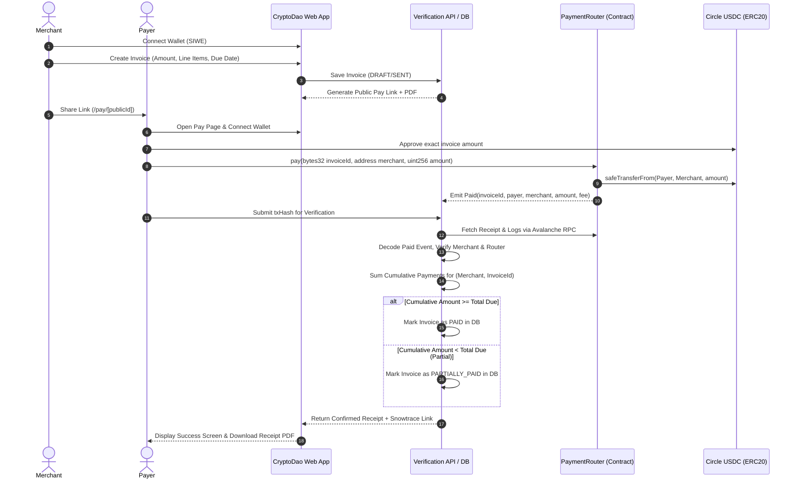

# CryptoDao

CryptoDao helps freelancers turn a USDC payment into an itemised invoice and a payment receipt. A client can pay a deposit and the balance against the same invoice, while the merchant receives tokens directly in their wallet.

The repository retains its original name, `raseed-fuji-demo`. CryptoDao is the product name used in the application.

[Open the live app](https://raseed-fuji-demo.vercel.app/) · [Try the interactive sample](https://raseed-fuji-demo.vercel.app/demo) · [Inspect the payment router](contracts/src/PaymentRouter.sol)

## Try the project

The **Try a Sample Invoice** button opens an English/Hindi walkthrough with fictional data. It shows a 250 USDC invoice, a 100 USDC deposit, the remaining 150 USDC payment, and a sample receipt. Sample interactions run locally in the browser and are labelled as simulations.

For the live testnet flow, open the merchant portal with a test wallet, sign in, create an invoice, and open its payment link in a payer wallet. Use Avalanche Fuji AVAX for gas and test USDC for payment. After payment, the server checks the router's events and the invoice total before recording settlement. Receipt PDFs include transaction explorer links.

The project currently runs on Avalanche Fuji. The application implements deterministic payment verification. AI-assisted development was used for the submission preparation changes, including the sample walkthrough, test review, and documentation.

## Run locally

Use Node.js 22 and PostgreSQL. Copy `.env.example` to `.env.local`, configure a local database and generated session secret, and explicitly set `NEXT_PUBLIC_FUJI_ROUTER_ADDRESS` from [`contracts/deployments.json`](contracts/deployments.json). For Prisma CLI commands, supply the same local database URL as `DATABASE_URL` and `DIRECT_URL` in the shell.

```sh
npm ci
npx prisma migrate deploy
npm run dev
```

Tests use a separate database configured as `TEST_DATABASE_URL`. Apply the committed migrations to that test database first, then run `npm test`. PDF tests also require `npx playwright install chromium`. Run `npx tsc --noEmit`, `npm run lint`, and `npm run build` for application checks. The sample walkthrough can be checked with `npx playwright test e2e/sample-invoice.spec.ts`.

---

> **Non-custodial, peer-to-peer stablecoin invoicing and payment links on Avalanche C-Chain.**  
> Zero custody. Direct settlement. Atomic on-chain routing.

---

## 1. Architecture Overview

CryptoDao connects merchants and payers directly without intermediaries holding custody of user assets. Payments are routed atomically from payer to merchant using native Circle USDC.



---

## 2. Key Architecture Pillars

| Component | Technology | Rationale |
|---|---|---|
| **Smart Contracts** | Solidity `^0.8.24`, Foundry, OpenZeppelin | Non-custodial, gas-efficient router with invariant tests and Slither static analysis run by the team (not an independent audit). Never holds funds: transfers tokens atomically from payer to merchant and keeps no token balance or per-invoice settlement state, preventing griefing. |
| **Blockchain** | Avalanche C-Chain | The public demo uses Fuji testnet and test USDC. Mainnet configuration is gated. |
| **Frontend** | Next.js (App Router), TypeScript, Tailwind CSS | High performance, accessible, server-side rendering for invoices & metadata. |
| **Web3 Client** | Wagmi, Viem, RainbowKit | Type-safe Ethereum interactions, robust connector management, exact allowance requests. |
| **Verification Engine** | Viem server-side RPC decoding | Zero trust in client state; deterministic event log verification against canonical blocks. |
| **Database & Auth** | PostgreSQL, Prisma ORM, SIWE (EIP-4361) | Zero password/key storage; cryptographic wallet authentication with signed session cookies. |
| **Documents** | Server-rendered HTML and Playwright Chromium | Invoice and receipt PDFs with embedded Devanagari fonts and transaction references. |
| **i18n** | English + Hindi JSON dictionaries | English and Hindi interfaces with Devanagari font support. |

---

## 3. Directory & File Tree

```
raseed-fuji-demo/
├── contracts/        # Solidity router, Foundry tests, deployment scripts
├── docs/             # Operations, security, deployment and scope notes
├── prisma/           # Schema and committed PostgreSQL migrations
├── src/app/          # Public pages, merchant portal, payment pages and APIs
├── src/components/   # Shared UI components
├── src/config/       # Network, contracts, branding and environment settings
├── src/lib/          # Auth, payment verification, PDFs and currency arithmetic
├── src/locales/      # English and Hindi translations
├── tests/            # Vitest unit and integration tests
└── e2e/              # Playwright browser flows
```

---

## 4. Anti-Griefing On-Chain Settlement Spec

1. **Zero Fund Custody**: The `PaymentRouter` smart contract holds zero balances at all times. Transfers execute directly from the payer to the merchant's wallet (and platform treasury if a fee is active) atomically.
2. **No Per-Invoice Settlement State**: The smart contract does NOT maintain an on-chain `isPaid[invoiceId]` mapping. Because smart contracts cannot know off-chain invoice total amounts, enforcing a single-payment invariant on-chain allows an attacker to front-run and brick any invoice by calling `pay(invoiceId, merchant, 1)`.
3. **Cumulative Off-Chain Settlement**: The off-chain engine monitors canonical `Paid` events emitted by `PaymentRouter` and aggregates confirmed payment amounts for each `(merchant, onchainInvoiceId)`. Invoices transition from `SENT` to `PARTIALLY_PAID`, and finally to `PAID` once the cumulative sum meets or exceeds `amountUsdc`.

---

## 5. Phase 5 Verification Rules

When a transaction hash is submitted or reconciled by the background engine:
1. **Receipt Status**: `status === "success"` (1).
2. **Contract Target**: Receipt `to` or event `address` must match `CURRENT_NETWORK.routerAddress`.
3. **Event Signature**: Decodes canonical `Paid(bytes32 indexed invoiceId, address indexed payer, address indexed merchant, uint256 amount, uint256 fee)` event.
4. **Log Verification**:
   - `invoiceId` matches invoice's `onchainInvoiceId`.
   - `merchant` matches invoice's `merchant.walletAddress`.
   - `chainId` matches current Avalanche network (`43113` Fuji / `43114` Mainnet).
5. **Idempotent Record**: Upserts into `PaymentEvent` table with unique constraint `(chainId, txHash, logIndex)`. All payers are recorded (`payerAddress`).
6. **Cumulative Summation**: Computes `SUM(amountUsdc)` for all confirmed events matching the invoice. If cumulative amount >= invoice target, updates status to `PAID` and timestamps `confirmedAt`.

---

## 6. Database Migrations & Deployment

CryptoDao uses Prisma with PostgreSQL (e.g. Neon serverless).

### Migration Commands
- **Remote / Non-Local / Production / Staging Databases**:
  ```bash
  npx prisma migrate deploy
  ```
  > **CRITICAL RULE**: ALWAYS use `prisma migrate deploy` for any non-local or remote database (including Neon branches and production). Never run `prisma migrate dev` against staging or production databases; `migrate deploy` applies pending committed migration SQL scripts idempotently without shadow databases or interactive resets.

- **Local Development (Schema Changes)**:
  ```bash
  npx prisma migrate dev --name <migration_name>
  ```

- **Integration Test Branch**:
  Deploy migrations to the isolated test database:
  ```bash
  DATABASE_URL="$TEST_DATABASE_URL" DIRECT_URL="$TEST_DATABASE_URL" npx prisma migrate deploy
  ```

---

## 7. Security Hardening & Observability Status
- **Error Monitoring**: PII scrubber implemented; error monitoring is NOT active yet (no Sentry.init).
- **Content Security Policy (CSP)**: Report-Only, includes 'unsafe-eval'/'unsafe-inline'; not yet enforcing.
- **Dependency Hygiene**: Next.js and its ESLint configuration were updated to 16.4.6 for submission preparation. The full `npm audit` on 24 November 2026 still reported 24 high and 9 moderate findings across the dependency tree, with no critical findings. These remaining advisories need dependency-by-dependency review; this is not a claim that the application is independently audited or ready for mainnet.
