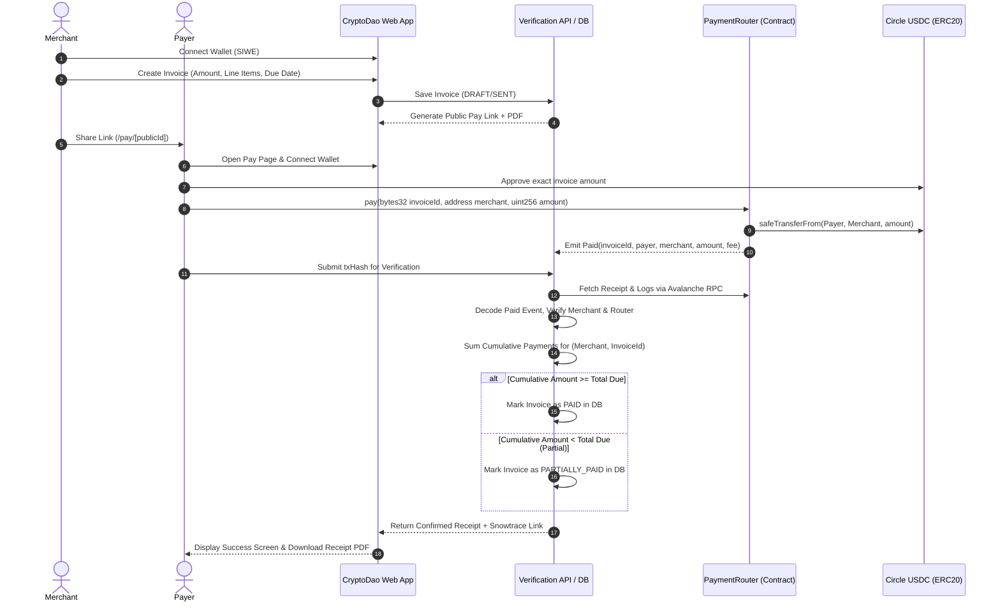

# CryptoDao

> **Non-custodial, peer-to-peer stablecoin invoicing and payment links on Avalanche C-Chain.**  
> Zero custody. Direct settlement. Atomic on-chain routing.

---

## 1. Architecture Overview

CryptoDao connects merchants and payers directly without intermediaries holding custody of user assets. Payments are routed atomically from payer to merchant using native Circle USDC.



---

## 2. Key Architecture Pillars

| Component | Technology | Rationale |
|---|---|---|
| **Smart Contracts** | Solidity `^0.8.24`, Foundry, OpenZeppelin | Non-custodial, gas-efficient router with invariant tests and Slither static analysis run by the team (not an independent audit). Never holds funds: transfers tokens atomically from payer to merchant and keeps no token balance or per-invoice settlement state, preventing griefing. |
| **Blockchain** | Avalanche C-Chain (Fuji Testnet & Mainnet) | Sub-second deterministic finality, sub-cent gas fees, native Circle USDC support. |
| **Frontend** | Next.js (App Router), TypeScript, Tailwind CSS | High performance, accessible, server-side rendering for invoices & metadata. |
| **Web3 Client** | Wagmi, Viem, RainbowKit | Type-safe Ethereum interactions, robust connector management, exact allowance requests. |
| **Verification Engine** | Viem server-side RPC decoding | Zero trust in client state; deterministic event log verification against canonical blocks. |
| **Database & Auth** | PostgreSQL, Prisma ORM, SIWE (EIP-4361) | Zero password/key storage; cryptographic wallet authentication with signed session cookies. |
| **Documents** | Server-side PDF generation (`@react-pdf/renderer`) | High-fidelity invoice and receipt PDFs matching tax and accounting requirements. |
| **i18n** | English + Hindi JSON dictionaries | Dual-language India-first support with dynamic font pairing and RTL/LTR support. |

---

## 3. Directory & File Tree

```
defi/
├── .github/
│   └── workflows/
│       └── ci.yml                 # CI pipeline: forge test, slither, vitest, lint, typecheck, build
├── contracts/
│   ├── foundry.toml               # Foundry configuration
│   ├── src/
│   │   ├── PaymentRouter.sol      # Zero-custody stablecoin payment router
│   │   └── interfaces/
│   │       └── IPaymentRouter.sol
│   ├── test/
│   │   ├── PaymentRouter.t.sol    # Unit, fuzz, fee, and invariant tests
│   │   └── mocks/
│   │       ├── MockUSDC.sol       # Mock ERC20 with permit support
│   │       ├── MockMaliciousToken.sol # Reentrancy & fee-on-transfer tests
│   │       └── MockRevertingToken.sol
│   └── script/
│       ├── DeployFuji.s.sol       # Deployment script for Fuji testnet
│       └── DeployMainnet.s.sol    # Deployment script for Avalanche Mainnet (gated)
├── docs/
│   ├── ARCHITECTURE.md            # Detailed technical architecture
│   ├── DECISIONS.md               # Architectural & product decisions record
│   ├── THREAT_MODEL.md            # Threat model, attack vectors & mitigations
│   ├── SECURITY.md                # Vulnerability disclosure & contact info
│   ├── OPERATIONS.md              # Ops, health checks, cron reconciliation & backups
│   ├── DEPLOY_FUJI.md             # Keystore deployment guide for Fuji
│   ├── SLITHER_REVIEW.md          # Slither static analysis configuration & review
│   └── MAINNET_LAUNCH_CHECKLIST.md # Checklist before mainnet activation
├── prisma/
│   ├── schema.prisma              # Data model: Merchant, Invoice, PaymentEvent, AuditLog
│   └── seed.ts                    # Testnet seed data for demo testing
├── src/
│   ├── app/                       # Next.js App Router pages and APIs
│   │   ├── api/
│   │   │   ├── auth/              # SIWE nonce, verify, session, logout
│   │   │   ├── invoices/          # Verification, PDF download, CSV export
│   │   │   ├── cron/reconcile/    # Background payment reconciliation cron
│   │   │   └── health/            # System & RPC health check
│   │   ├── layout.tsx             # Root layout with Web3Provider & i18n
│   │   └── page.tsx               # Public landing page
│   ├── components/                # Reusable UI components & design system
│   │   ├── common/                # Buttons, inputs, modals, toasts, language selector
│   │   └── layout/                # Navbar, footer, network banner, test-mode ribbon
│   ├── config/
│   │   ├── branding.ts            # Central branding configuration (Product name: CryptoDao)
│   │   ├── network.ts             # Avalanche Fuji & Mainnet RPC, contracts & USDC addresses
│   │   ├── constants.ts           # Financial constants (MIN_INVOICE_USDC, DUST_THRESHOLD)
│   │   └── env.ts                 # Validated environment configuration (Zod)
│   ├── lib/
│   │   ├── auth/                  # SIWE verification & session management
│   │   ├── db/                    # Prisma client instance
│   │   ├── rate-limit.ts          # Rate limiter (Upstash / in-memory fallback)
│   │   └── currency.ts            # USDC micro-unit formatters & INR reference rates
│   └── locales/
│       ├── en.json                # Complete English UI strings
│       └── hi.json                # Complete Hindi UI strings (Devanagari)
├── package.json
└── tsconfig.json
```

---

## 4. Anti-Griefing On-Chain Settlement Spec

1. **Zero Fund Custody**: The `PaymentRouter` smart contract holds zero balances at all times. Transfers execute directly from the payer to the merchant's wallet (and platform treasury if a fee is active) atomically.
2. **No Per-Invoice Settlement State**: The smart contract does NOT maintain an on-chain `isPaid[invoiceId]` mapping. Because smart contracts cannot know off-chain invoice total amounts, enforcing a single-payment invariant on-chain allows an attacker to front-run and brick any invoice by calling `pay(invoiceId, merchant, 1)`.
3. **Cumulative Off-Chain Settlement**: The off-chain engine monitors canonical `Paid` events emitted by `PaymentRouter` and aggregates confirmed payment amounts for each `(merchant, onchainInvoiceId)`. Invoices transition from `SENT` to `PARTIALLY_PAID`, and finally to `PAID` once the cumulative sum meets or exceeds `amountUsdc`.

---

## 5. Phase 5 Verification Rules

When a transaction hash is submitted or reconciled by the background engine:
1. **Receipt Status**: `status === "success"` (1).
2. **Contract Target**: Receipt `to` or event `address` must match `CURRENT_NETWORK.routerAddress`.
3. **Event Signature**: Decodes canonical `Paid(bytes32 indexed invoiceId, address indexed payer, address indexed merchant, uint256 amount, uint256 fee)` event.
4. **Log Verification**:
   - `invoiceId` matches invoice's `onchainInvoiceId`.
   - `merchant` matches invoice's `merchant.walletAddress`.
   - `chainId` matches current Avalanche network (`43113` Fuji / `43114` Mainnet).
5. **Idempotent Record**: Upserts into `PaymentEvent` table with unique constraint `(chainId, txHash, logIndex)`. All payers are recorded (`payerAddress`).
6. **Cumulative Summation**: Computes `SUM(amountUsdc)` for all confirmed events matching the invoice. If cumulative amount >= invoice target, updates status to `PAID` and timestamps `confirmedAt`.

---

## 6. Database Migrations & Deployment

CryptoDao uses Prisma with PostgreSQL (e.g. Neon serverless).

### Migration Commands
- **Remote / Non-Local / Production / Staging Databases**:
  ```bash
  npx prisma migrate deploy
  ```
  > **CRITICAL RULE**: ALWAYS use `prisma migrate deploy` for any non-local or remote database (including Neon branches and production). Never run `prisma migrate dev` against staging or production databases; `migrate deploy` applies pending committed migration SQL scripts idempotently without shadow databases or interactive resets.

- **Local Development (Schema Changes)**:
  ```bash
  npx prisma migrate dev --name <migration_name>
  ```

- **Integration Test Branch**:
  Deploy migrations to the isolated test database:
  ```bash
  DATABASE_URL="$TEST_DATABASE_URL" DIRECT_URL="$TEST_DATABASE_URL" npx prisma migrate deploy
  ```

---

## 7. Security Hardening & Observability Status
- **Error Monitoring**: PII scrubber implemented; error monitoring is NOT active yet (no Sentry.init).
- **Content Security Policy (CSP)**: Report-Only, includes 'unsafe-eval'/'unsafe-inline'; not yet enforcing.
- **Dependency Hygiene**: 25 vulnerabilities reported by `npm audit --omit=dev` (3 high in prisma CLI chain, 22 moderate in wallet stack). `npm audit fix --force` would downgrade prisma, so it was NOT run. The 3 high prisma CLI findings are verified not reachable at runtime in our code (`src/` imports only `@prisma/client`); the 22 moderate wallet findings are not verified.

